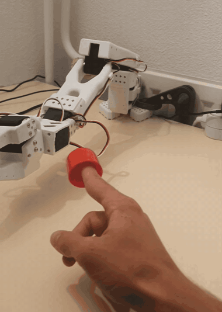

# Bras robotisé SO-ARM101 — saisie guidée par la vision

Pilotage complet d'un bras à 5 axes depuis un Raspberry Pi 5 : pilote série
écrit de zéro, cinématique inverse, étalonnage œil-main, asservissement continu
et saisie guidée par une caméra.

Aucun SDK constructeur, aucun framework robotique — tout est construit à partir
du protocole série et de l'URDF officiel, pour comprendre chaque maillon.

<p align="center">
  
</p>

<p align="center">
  <em>Le bras suit le doigt en direct : la caméra repère le repère coloré, une
  cinématique différentielle convertit l'écart en consigne articulaire, et une
  boucle à 50 Hz maintient la pince à 1,5 cm en avant.</em><br>
  <a href="https://youtube.com/shorts/wYSlx46ZlL8">▶ Démonstration complète (1 min)</a>
</p>

---

## Ce que ça fait

Un objet est posé sur la table. La caméra le repère, l'homographie convertit ses
pixels en millimètres dans le repère du bras, la cinématique inverse calcule les
angles, et une boucle d'asservissement à 50 Hz amène la pince dessus sans
à-coup. Sur commande, les mors s'orientent perpendiculairement à l'objet et le
saisissent.

Le bras peut aussi suivre une cible mobile en direct, la pince se tenant en
retrait de quelques centimètres.

---

## Le matériel

| | |
|---|---|
| Bras | SO-ARM101, 5 axes + pince, servos Feetech STS3215 |
| Calculateur | Raspberry Pi 5 |
| Caméra | Module Camera 3 (capteur imx708) |
| Liaison | série demi-duplex 1 Mbaud, via carte USB |

---

## Architecture

Le code est découpé pour qu'aucune couche n'ait besoin de connaître les
suivantes.

```
cinematique/     la géométrie, sans aucun matériel
  ik.py            cinématique directe et inverse (ikpy + URDF officiel)
  jacobienne.py    cinématique différentielle, pour le suivi temps réel
  orientation.py   quel roulis de poignet pour saisir un objet donné
  securite.py      un mouvement est-il recevable ?
  enveloppe.py     où la pince peut-elle réellement aller ?

materiel/        le bras, réel ou simulé
  sts3215.py       pilote série, écrit à partir du protocole SMS/STS
  interface.py     les cinq questions qu'on pose à un bras
  servos.py        back-end sur les vrais servos
  simulation.py    back-end sans matériel, mêmes refus
  asservissement.py boucle de commande continue à 50 Hz
  etalonnage.py    butées mesurées, correspondance angle URDF <-> degré servo

vision/          les yeux
  camera.py        accès caméra, partagé par tout le reste
  detection.py     repérage par couleur, position ET orientation
  etalonnage_camera.py  étalonnage œil-main

apps/            les applications
  suivi.py         suit une cible en direct, la saisit sur commande
```

Le point qui tient l'ensemble est `materiel/interface.py` : une interface
abstraite de cinq méthodes. Le code de vision et d'application ne sait pas s'il
pilote des servos ou une simulation, ce qui permet d'écrire et d'éprouver une
séquence entière sans brancher le bras.

---

## Quelques problèmes résolus

Ce projet vaut surtout par les défauts qu'il a fallu trouver. Les chiffres
ci-dessous sont mesurés, pas estimés.

**Un axe que l'optimiseur choisissait au hasard.** La cible d'une cinématique
inverse est ici un point, sans orientation, et le roulis du poignet ne déplace
la pince que de 1 mm par 10°. Pour l'optimiseur, c'était donc un paramètre
libre, qu'il fixait arbitrairement : trois cibles distantes de 1 cm donnaient
+161°, +56° et +161° de roulis, toutes à 0,00 mm de la cible. Le garde-fou
d'écart articulaire refusait alors la plupart des mouvements. Le roulis a été
retiré de l'optimisation et rendu à sa vraie fonction, orienter la pince.

**Des à-coups qui venaient de l'architecture.** L'ancien pilotage découpait
chaque trajet en paliers de 10° et attendait l'arrivée à chacun : le bras
décélérait jusqu'à l'arrêt une dizaine de fois par mouvement. Le remplacement
par une consigne rafraîchie à 50 Hz, jamais interrompue, a donné sur le même
trajet **8,91 s → 1,98 s**, sans un seul arrêt intermédiaire.

**Quinze allers-retours série par palier.** Les consignes partaient registre par
registre et servo par servo, chacune attendant son accusé. L'instruction SYNC
WRITE du protocole permet de tout porter dans une trame unique : **15,00 ms →
0,25 ms**, mesuré sur le bras. Les cinq axes reçoivent désormais leur consigne
dans la même milliseconde.

**Une cinématique inverse trop lente pour suivre.** L'optimiseur met 18 ms en
médiane et jusqu'à 328 ms au pire — impossible d'asservir sur une cible mobile.
Pour un petit déplacement, une passe de cinématique directe donne la jacobienne
et la correction sort d'une inversion 3×3 : **231 µs, soit 45× plus rapide**. La
méthode ne peut de surcroît pas changer de configuration du bras, ce qui élimine
par construction les retournements d'axe à 150°.

**Deux tiers du capteur inutilisés.** Le capteur de la caméra expose un mode
recadré que la bibliothèque choisit silencieusement pour une sortie en 720p. En
forçant le mode pleine surface, le champ de vision gagne **un facteur 1,5 dans
chaque direction** — ce qui a résolu un problème de cadrage sans toucher à la
caméra.

**Une erreur mesurée honnêtement.** L'étalonnage œil-main affiche 6,5 mm
d'erreur de reprojection, mais ce chiffre est mesuré sur les points qui ont servi
à l'ajustement. Une validation croisée donne **9,8 mm**, et c'est celui-là qui
compte. Plus important encore, la parallaxe due à un objet 3 cm plus bas que le
plan étalonné vaut **27 à 30 mm** — trois fois l'erreur d'étalonnage.

---

## L'étalonnage œil-main, sans mire imprimée

La caméra dit « objet au pixel (712, 383) », le bras va en mètres. Pour relier
les deux, la méthode habituelle est d'imprimer un damier. Ici, **le bras est sa
propre mire** : on amène la pince à des positions que le modèle connaît
exactement, on photographie, et on pointe la pince dans chaque image.

C'est même préférable à une mire : celle-ci donne la relation caméra ↔ mire,
qu'il reste à relier au bras, alors qu'on mesure ici directement la relation
caméra ↔ bras.

Les objets à saisir reposant tous sur la table, la transformation cherchée est
une homographie, ajustée par RANSAC pour qu'un pointage manqué soit écarté
plutôt que de tirer le résultat.

```bash
python -m vision.etalonnage_camera cadrage    # la zone tient-elle dans le champ ?
python -m vision.etalonnage_camera capturer   # le bras parcourt une grille
python -m vision.etalonnage_camera pointer    # on pointe la pince
python -m vision.etalonnage_camera ajuster    # homographie + erreur
python -m vision.etalonnage_camera viser --aller   # on clique, le bras y va
```

---

## Sécurité

Faire aller un bras plus vite ne doit pas le rendre moins prudent.

- Toute consigne est bornée par les **butées mesurées à la main**, plus sûres
  que celles de l'URDF : le coude y est déclaré à +96,8° pour une butée réelle
  à +47,7°.
- **Vitesse et accélération articulaires bornées**, ce qui supprime les à-coups
  à la source.
- **Plancher cartésien** : aucune consigne ne descend sous 2,5 cm. Les butées
  articulaires n'empêchent nullement d'écraser la pince sur la table.
- **Surveillance de charge** en continu, un axe par cycle : au-delà du seuil,
  tout s'arrête.
- **Arrêt d'urgence par fichier témoin** : `touch /tmp/bras-stop` fige le bras
  depuis n'importe quelle session, sans toucher au bus série — deux processus
  qui émettent sur une liaison demi-duplex se brouilleraient.
- Une cible que le bras ne peut pas atteindre est **ignorée**, et non approchée
  au plus près.

---

## Démarrer

```bash
git clone <ce dépôt> && cd bras-robot
python3 -m venv venv && venv/bin/pip install -r requirements.txt

# Sans aucun matériel : le bras simulé, mêmes sécurités, mêmes refus
venv/bin/python -m materiel.test_bras --simu etat
venv/bin/python -m materiel.simulation          # un cycle de saisie complet
venv/bin/python comprendre_simulation.py        # comment tout cela fonctionne

# Avec le bras
venv/bin/python -m materiel.test_servos scan
venv/bin/python -m materiel.pilote              # pilotage au clavier
venv/bin/python -m apps.suivi --couleur rouge   # suivi et saisie
```

`comprendre_simulation.py` est une leçon exécutable en cinq étapes : l'état, la
cinématique directe, la boucle de simulation, le problème inverse, et ce que la
simulation ne sait pas faire.

---

## Limites connues

Dites franchement, parce qu'elles décident de ce qui marche et de ce qui ne
marche pas.

- **L'homographie ne vaut que pour un plan.** Un pixel désigne un rayon, pas un
  point : c'est le plan étalonné qui lève l'ambiguïté. Un objet plus haut ou
  plus bas est localisé à côté, proportionnellement à son écart. S'en affranchir
  demanderait deux caméras, un capteur de profondeur, ou un étalonnage à deux
  hauteurs.
- **La simulation ignore la physique.** Ni gravité, ni contact, ni couple : elle
  valide la géométrie et la logique, jamais la sûreté. Une trajectoire validée
  en simulation peut traverser la table.
- **Aucune détection de collision.** Ni avec la table, ni du bras avec lui-même.
  C'est la surveillance de charge qui protège, a posteriori.
- **La pince ouvre à environ 3,5 cm.** Au-delà, l'objet n'est pas saisissable
  autrement que par un coin.
- **Certaines orientations de saisie sont inatteignables** selon la posture : le
  roulis tourne autour de l'avant-bras, ce qui contraint le plan dans lequel les
  mors peuvent s'écarter. Le code le détecte et le signale plutôt que de serrer
  de travers.

---

## Ce qui reste à faire

- Étalonnage à deux hauteurs, pour localiser un objet quelle que soit son
  épaisseur
- Détection par apprentissage plutôt que par couleur
- Séquence de saisie complète autonome, du repérage à la dépose

---

Le code et les commentaires sont en français. Les messages de commit
documentent les mesures et les impasses autant que les solutions : c'est
souvent ce qu'on ne retrouve plus six mois après.
